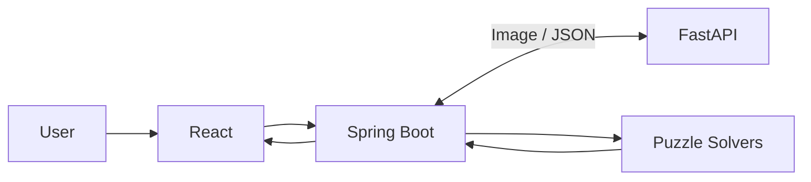

# 🧩 Puzzle Solver

A full-stack puzzle-solving application built with React, Java, Spring Boot, Python, and FastAPI.

The application extracts puzzle data from images using computer vision and solves puzzles using 
algorithms implemented in Java.

## Features

- Word Search Solver (Trie + DFS)
- Sudoku Solver (Backtracking) — Planned
- Image Recognition (OpenCV + OCR)
- REST API
- Support for multiple puzzle types

## Tech Stack

- React
- Java 21
- Spring Boot
- Python
- FastAPI
- OpenCV
- OCR

## Architecture

The system consists of two applications service and front end view:

1. **Spring Boot API:** Handles requests and puzzle-solving logic.
2. **FastAPI Service:** Extracts structured puzzle data from images.
3. **React Front end:** User friendly for updating images.

### System Architecture

## Architecture Documentation

Detailed design documentation:

- [System Context](docs/architecture/system-context.md)
- [Container Diagram](docs/architecture/container-diagram.md)
- [Sequence Diagram](docs/architecture/sequence-diagram.md)
- [UML Class Diagram](docs/architecture/class-diagram.md)
- [Image Processing Pipeline](docs/architecture/image-processing.md)

## API Documentation

- [API Contract](docs/api/api-contract.md)

## Getting Started

Instructions will be added as the project develops.

## Roadmap

- [ ] Implement FastAPI image upload endpoint
- [ ] FastAPI image processing
- [ ] Create Spring Boot REST API
- [ ] Connect Spring Boot and FastAPI
- [ ] Implement Word Search Solver
- [ ] Implement OCR extraction
- [ ] Implement Sudoku Solver
- [ ] React frontend
- [ ] Add Docker support
- [ ] Add automated tests