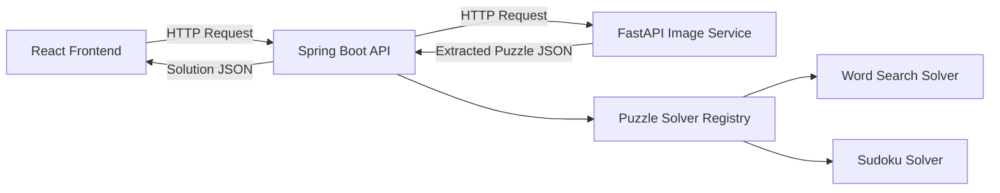
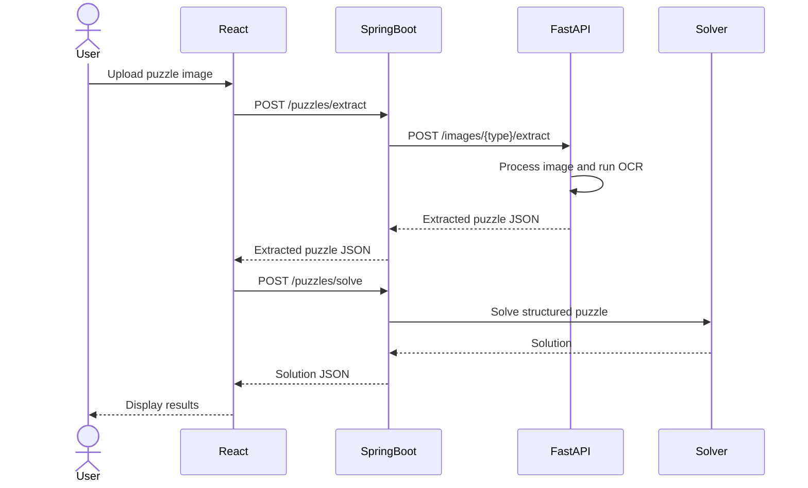

# Puzzle Solver — API Contract

## 1. Overview

Puzzle Solver is an application that extracts puzzle data from images
and solves puzzles using dedicated algorithms.

The system consists of three main components:

- **Frontend:** React
- **Backend API:** Java + Spring Boot
- **Image Processing Service:** Python + FastAPI

### Architecture



---

## 2. API Conventions

### Base URLs

Spring Boot API:

`http://localhost:8080/api/v1`

FastAPI Image Processing Service:

`http://localhost:8000/api/v1`

### Supported Puzzle Types

| Type | Description |
|---|---|
| `WORD_SEARCH` | Traditional word search puzzle |
| `SUDOKU` | Standard 9x9 Sudoku puzzle |

### Coordinate System

All coordinates use zero-based indexing.

- `row`: Row index, starting at 0.
- `col`: Column index, starting at 0.
- `(0,0)`: Top-left cell.

### Content Types

- JSON requests: `application/json`
- Image uploads: `multipart/form-data`
- JSON responses: `application/json`

---

# 3. Spring Boot API

The Spring Boot API is the main entry point for frontend requests.

Responsibilities:

1. Receive puzzle images.
2. Validate requests.
3. Communicate with the Python image processing service.
4. Route puzzles to the appropriate solver.
5. Return solutions to the frontend.

---

## 3.1 Extract Puzzle From Image

### Endpoint

`POST /api/v1/puzzles/extract`

### Description

Uploads a puzzle image and returns its structured representation.

This endpoint does not solve the puzzle.

### Request

Content-Type: `multipart/form-data`

| Field | Type | Required | Description |
|---|---|---|---|
| `file` | File | Yes | Puzzle image |
| `puzzleType` | String | Yes | `WORD_SEARCH` or `SUDOKU` |

### Example Request

```bash
curl -X POST \
  http://localhost:8080/api/v1/puzzles/extract \
  -F "file=@puzzle.jpg" \
  -F "puzzleType=WORD_SEARCH"
```

### Response — Word Search

HTTP Status: `200 OK`

```json
{
  "puzzleType": "WORD_SEARCH",
  "rows": 4,
  "cols": 5,
  "board": [
    ["G", "A", "T", "O", "S"],
    ["P", "E", "R", "R", "O"],
    ["L", "I", "B", "R", "O"],
    ["C", "A", "S", "A", "X"]
  ],
  "words": [
    "GATO",
    "PERRO",
    "LIBRO",
    "CASA"
  ]
}
```

### Response — Sudoku

HTTP Status: `200 OK`

```json
{
  "puzzleType": "SUDOKU",
  "board": [
    [5,3,0,0,7,0,0,0,0],
    [6,0,0,1,9,5,0,0,0],
    [0,9,8,0,0,0,0,6,0],
    [8,0,0,0,6,0,0,0,3],
    [4,0,0,8,0,3,0,0,1],
    [7,0,0,0,2,0,0,0,6],
    [0,6,0,0,0,0,2,8,0],
    [0,0,0,4,1,9,0,0,5],
    [0,0,0,0,8,0,0,7,9]
  ]
}
```

For Sudoku, `0` represents an empty cell.

---

## 3.2 Solve Puzzle

### Endpoint

`POST /api/v1/puzzles/solve`

### Description

Receives structured puzzle data and returns a solution.

The solver is selected using `puzzleType`.

### Request

Content-Type: `application/json`

### Word Search Request

```json
{
  "puzzleType": "WORD_SEARCH",
  "board": [
    ["G", "A", "T", "O", "S"],
    ["P", "E", "R", "R", "O"],
    ["L", "I", "B", "R", "O"],
    ["C", "A", "S", "A", "X"]
  ],
  "words": [
    "GATO",
    "PERRO",
    "LIBRO",
    "CASA"
  ]
}
```

### Word Search Response

HTTP Status: `200 OK`

```json
{
  "puzzleType": "WORD_SEARCH",
  "matches": [
    {
      "word": "GATO",
      "start": {
        "row": 0,
        "col": 0
      },
      "end": {
        "row": 0,
        "col": 3
      }
    },
    {
      "word": "CASA",
      "start": {
        "row": 3,
        "col": 0
      },
      "end": {
        "row": 3,
        "col": 3
      }
    }
  ],
  "notFound": [
    "PERRO",
    "LIBRO"
  ]
}
```

**Note:** This response is illustrative of the format.
Actual matches must be calculated by the solver.

### Word Search Rules

- Words must follow a straight line.
- Eight directions are supported.
- Words may be reversed.
- Words may overlap.
- A direction cannot change during a word.
- Matching is case-insensitive.
- The solver returns zero-based coordinates.

### Sudoku Request

```json
{
  "puzzleType": "SUDOKU",
  "board": [
    [5,3,0,0,7,0,0,0,0],
    [6,0,0,1,9,5,0,0,0],
    [0,9,8,0,0,0,0,6,0],
    [8,0,0,0,6,0,0,0,3],
    [4,0,0,8,0,3,0,0,1],
    [7,0,0,0,2,0,0,0,6],
    [0,6,0,0,0,0,2,8,0],
    [0,0,0,4,1,9,0,0,5],
    [0,0,0,0,8,0,0,7,9]
  ]
}
```

### Sudoku Response

HTTP Status: `200 OK`

```json
{
  "puzzleType": "SUDOKU",
  "solved": true,
  "board": [
    [5,3,4,6,7,8,9,1,2],
    [6,7,2,1,9,5,3,4,8],
    [1,9,8,3,4,2,5,6,7],
    [8,5,9,7,6,1,4,2,3],
    [4,2,6,8,5,3,7,9,1],
    [7,1,3,9,2,4,8,5,6],
    [9,6,1,5,3,7,2,8,4],
    [2,8,7,4,1,9,6,3,5],
    [3,4,5,2,8,6,1,7,9]
  ]
}
```

### Sudoku Rules

- The board must contain exactly 9 rows.
- Each row must contain exactly 9 integers.
- Allowed values: 0–9.
- Zero represents an empty cell.
- Existing values cannot be modified.
- The solution must satisfy standard Sudoku rules.

---

# 4. FastAPI Image Processing Service

The Python service is responsible only for image processing.

It does not solve puzzles.

Responsibilities:

1. Receive an image.
2. Detect the puzzle region.
3. Correct image perspective when necessary.
4. Extract characters or digits using OCR.
5. Extract the word list for word searches.
6. Return structured puzzle data.

---

## 4.1 Extract Word Search

### Endpoint

`POST /api/v1/images/word-search/extract`

### Request

Content-Type: `multipart/form-data`

| Field | Type | Required | Description |
|---|---|---|---|
| `file` | File | Yes | Word search image |

### Response

HTTP Status: `200 OK`

```json
{
  "puzzleType": "WORD_SEARCH",
  "rows": 4,
  "cols": 5,
  "board": [
    ["G", "A", "T", "O", "S"],
    ["P", "E", "R", "R", "O"],
    ["L", "I", "B", "R", "O"],
    ["C", "A", "S", "A", "X"]
  ],
  "words": [
    "GATO",
    "PERRO",
    "LIBRO",
    "CASA"
  ]
}
```

---

## 4.2 Extract Sudoku

### Endpoint

`POST /api/v1/images/sudoku/extract`

### Request

Content-Type: `multipart/form-data`

| Field | Type | Required | Description |
|---|---|---|---|
| `file` | File | Yes | Sudoku image |

### Response

HTTP Status: `200 OK`

```json
{
  "puzzleType": "SUDOKU",
  "board": [
    [5,3,0,0,7,0,0,0,0],
    [6,0,0,1,9,5,0,0,0],
    [0,9,8,0,0,0,0,6,0],
    [8,0,0,0,6,0,0,0,3],
    [4,0,0,8,0,3,0,0,1],
    [7,0,0,0,2,0,0,0,6],
    [0,6,0,0,0,0,2,8,0],
    [0,0,0,4,1,9,0,0,5],
    [0,0,0,0,8,0,0,7,9]
  ]
}
```

---

# 5. Error Handling

All services should return consistent error responses.

### Error Response Format

```json
{
  "error": {
    "code": "INVALID_IMAGE",
    "message": "The uploaded file is not a valid image."
  }
}
```

### HTTP Status Codes

| Status | Code | Description |
|---|---|---|
| 200 | OK | Request processed successfully |
| 400 | INVALID_REQUEST | Invalid request parameters |
| 400 | INVALID_PUZZLE | Invalid puzzle structure |
| 413 | FILE_TOO_LARGE | Uploaded file exceeds size limit |
| 415 | UNSUPPORTED_MEDIA_TYPE | Unsupported image format |
| 422 | EXTRACTION_FAILED | Puzzle could not be extracted |
| 500 | INTERNAL_ERROR | Unexpected server error |
| 502 | IMAGE_SERVICE_ERROR | Image processing service failed |
| 504 | IMAGE_SERVICE_TIMEOUT | Image processing service timed out |

---

# 6. Supported Image Formats

Initially supported formats:

- JPEG
- PNG

Additional formats may be supported in future versions.

Maximum upload size: 10 MB.

---

# 7. End-to-End Workflow



---

# 8. Future Improvements

Potential future features:

- Automatic puzzle type detection.
- OCR confidence scores.
- Manual correction of extracted characters.
- Highlighting solved words on the original image.
- Support for multiple puzzles in one image.
- Additional puzzle solvers.
- Solution visualization.
- Puzzle generation.
- Processing history.

---

# 9. API Versioning

All endpoints use versioned URLs:

`/api/v1/`

Breaking API changes should introduce a new version.

Example:

`/api/v2/puzzles/solve`

---

# 10. Implementation Status

| Component | Status |
|---|---|
| React Frontend | Planned |
| Spring Boot API | Planned |
| FastAPI Image Service | Planned |
| Word Search Solver | Planned |
| Sudoku Solver | Planned |

This document defines the initial API contract.

Endpoints and schemas may evolve as the project develops.